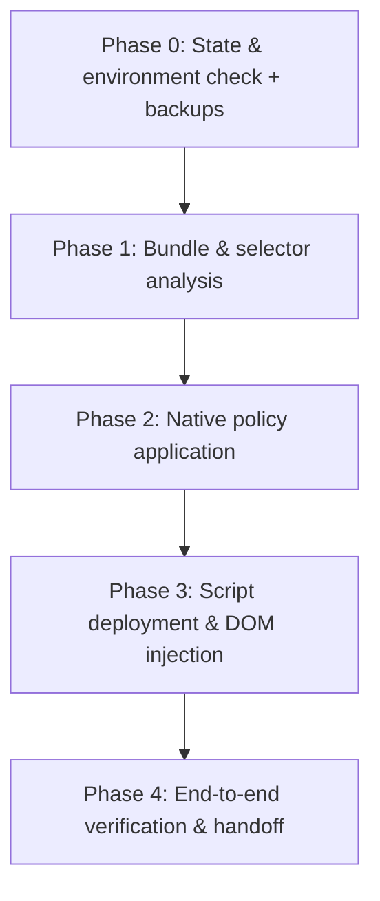

# Auto-Accept Orchestrator Skill

Central coordination skill of the Antigravity Auto-Accept harness.

## 5-Phase Lifecycle Workflow

### Phase 0: State & Backup
1. Verify the workbench folder exists:
   `$env:LOCALAPPDATA\Programs\Antigravity IDE\resources\app\out\vs\code\electron-browser\workbench`
2. Ensure a `.bak` backup exists for **both** `workbench.html` and `workbench-jetski-agent.html`
   before any modification.

### Phase 1: Source Analysis
- Dispatch `reverse-engineer` to check whether the `oVt` component and the
  `interaction-continue-button` selector still exist in `out/jetskiAgent/main.js`
  (the real bundle — not the stub `jetskiAgent.js` in the workbench folder) after a Google update.

### Phase 2: Native Policy
- Dispatch `policy-architect` to write into `%APPDATA%\Antigravity IDE\User\settings.json`:
  - `antigravity.cascadeAutoExecutionPolicy: "always-proceed"`
  - `antigravity.terminalAutoExecutionPolicy: "always-proceed"`
  - `antigravity.artifactReviewMode: "always-proceed"`

### Phase 3: Injection
- Dispatch `dom-injector` to copy `auto-accept.js` into the workbench folder and insert the
  `<script src="./auto-accept.js">` tag into **BOTH** HTML documents.
  CSP enforces Trusted Types — the script must contain no `innerHTML` sinks.

### Phase 4: Verification & Handoff
- Dispatch `qa-verifier`: run `verify.ps1`, then instruct the user to reload the window
  (`Ctrl + Shift + P` → `Reload Window`) and confirm the 🟢 badge plus a live tool call.

## Edge Cases
- **Google update wiped the patch or changed selectors:** re-run `install.ps1`; if selectors moved,
  use the `bundle-analysis` skill first, then update `auto-accept.js` and reinstall.
- **Badge visible but popups persist:** the popup may render inside a `vscode-webview` iframe that
  the window-level script cannot reach — dispatch `reverse-engineer` to trace the popup's host document.
- **User wants to pause auto-clicking:** click the floating badge `🟢 Auto-Accept: ON` → `⚪ PAUSED`.
- **Full removal:** run `uninstall.ps1` (restores both HTMLs from `.bak`, deletes the script).
